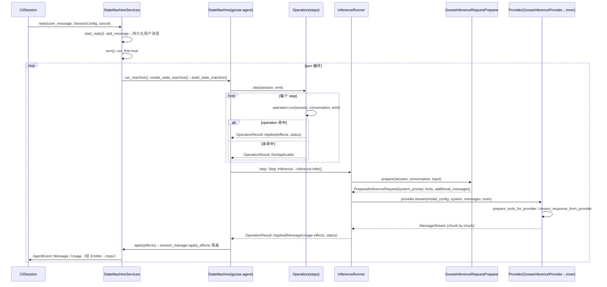

# 03 · 详细逐步说明：主链路拆解

> 层级：L3 详细逐步 · 沿 L2 的 `goose run` 路径，逐跳拆解状态机 pipeline：谁调谁、参数如何传、返回如何处理、状态如何变、错误如何传播。配 Mermaid 时序图。

## 概要

从用户消息进入 `StateMachineServices::reply` 到 assistant 消息回流，核心是三层：

1. **turn 编排**（`services.rs`）：turn 循环、确认等待、machine 运行；
2. **状态机**（`goose-agent/src/machine.rs`）：`step → apply → run`，每轮依次跑 operations + inference；
3. **推理链路**（`inference.rs` + `ops_llm.rs` + `reply_parts.rs`）：请求准备 → provider 流式推理 → 消息/usage 事件产出。

## Mermaid 时序图



## 第一跳：`reply` → `start_reply` → `turn`

### `reply`（services.rs · reply+0）

`Arc<Self>::reply` 是**唯一对外公开的会话入口**（CLI/ACP/gateway 共用）。

```rust
events = with_session_id(Some(session_id), start_reply(...)).await
Ok(Box::pin(events.try_filter_map(user_event).instrument(reply_span)))
```

- 用 `with_session_id` 把本次 turn 的 session 上下文注入 provider 请求（`session_context.rs`），保证 provider 调用带 `agent-session-id`。
- `user_event`（services.rs · user_event+0）把非用户可见事件过滤掉——CLI 只收到要渲染的事件。

### `start_reply`（services.rs · start_reply+0）

关键动作：

| 动作 | 源码 | 说明 |
|---|---|---|
| `with_generated_id_if_missing` | `start_reply+6` | 给消息补 id |
| ElicitationResponse 特例 | `start_reply+20~+55` | 若消息是 elicitation 回复，直接 `complete_elicitation_with_message` 并返回空流（本例不走） |
| 取 turn_guard + evicted | `start_reply+57~+66` | `runtime.lock_lifetime` → `confirmations.session(&id).try_start_turn()` → `runtime.touch(&id)`；evicted 的旧会话被 `evict()` 释放 |
| `start_new_turn` | `start_reply+68` | turn_guard.state 记新轮 |
| `schedule_id` 持久化 | `start_reply+70` | 若有 schedule 写回 session |
| **add_message** | `start_reply+78` | `session_manager.add_message(&session_config.id, &user_message)`——用户消息先落盘 |
| 会话命名 | `start_reply+81` | 后台 `maybe_update_name`（disable_session_naming=false 时） |
| 调 turn | `start_reply+102` | `self.turn(session_config, cancel, turn_guard, true)` |

### `turn`（services.rs · turn+0）

返回 `async_stream::try_stream!`，驱动整个 turn 循环：

```rust
loop {
    if run {
        stream = services.run_machine(session_config, cancel).await?;  // 跑状态机
        has_confirmations = false;
        while let Some(event) = stream.next() {
            for request_id in services.tool_confirmation_request_ids(&event) {
                turn_guard.state().register_request(request_id);
                has_confirmations = true;
            }
            yield event;      // 事件给 CLI
        }
        if !has_confirmations { break; }   // 无待确认工具 → 结束
    }
    // 有确认 → 等所有确认答复
    if !turn_guard.state().wait_for_all_confirmation_answers(&cancel).await { break; }
    run = true;   // 再跑一轮
}
turn_guard.state().clear_confirmations();
turn_end.finish().await;
```

要点：
- 一个 turn 可能跑 **多轮状态机**：每次遇到工具确认就暂停，等用户答复后 `run=true` 继续。
- 事件经 `yield` 实时流出，CLI 在消费流的同时等待下一个事件。

## 第二跳：`run_machine` → `create_state_machine`

### `run_machine`（services.rs · run_machine+0）

```rust
provider = self.provider(&session_id)               // ProviderManager 取 Arc<dyn Provider>
model_config = self.effective_model_config_for_session(...)
session = session_manager.get_session(&session_id, true)  // 读会话（含 conversation）
saved_provider_session_id = latest_provider_session_id(...)
if saved { provider.resume(saved_provider_session_id) }     // 恢复远端 provider 会话
provider.apply_model_selection(&model_config)               // 应用模型选择
context_limit = get_context_limit(provider, model_name)
steer_queue = runtime.steer_queue(&session_id)
machine = create_state_machine(provider, model_config, context_limit, session_config, cancel, steer_queue)
```

建 `mpsc` channel + `Emitter`，调 `run_goose(&machine, session_manager, &hook_manager, &session_id, &emit)`（`run_machine+58`），`tokio::select!` 同时消费 `rx` 事件和 `run` 完成：

```rust
loop {
    tokio::select! {
        biased;
        Some(event) = rx.recv() => yield event,   // 推理/工具事件实时流出
        result = &mut run => break result,        // run_goose 结束
    }
}
result?;
drop(emit副本);
while let Some(event) = rx.recv() { yield event; }  // 排空剩余事件
```

### `create_state_machine`（services.rs · create_state_machine+0 → +750）

- `TurnSettings::from_config`（services.rs · from_config+0）从配置读 `max_turns`、`compaction_threshold`、`tool_call_cutoff`、`retry_timeout`、`on_failure_timeout`、`stop_hook_block_cap`、`auto_effort`、`context_relevance`。
- `capped_compaction_threshold` + `compute_tool_call_cutoff`（context_mgmt）算压缩阈值。
- `build_state_machine(StateMachineConfig{...})`（state_machine_builder.rs · build_state_machine+0）组装 operations + inference（清单见 01 / L4d）。

## 第三跳：`StateMachine::step` 逐 operation 执行

### `step`（machine.rs · step+0）

```rust
for (index, step) in steps.enumerate() {
    if cancel.is_cancelled() { return empty_result(Cancelled); }
    execution = match step {
        Step::Operation(op) => op.run(session, conversation, emit),
        Step::Inference(inf) => {
            prepared = inf.prepare_session(session).await?;      // 扩展快照/租约
            session = prepared.unwrap_or(session);
            conversation = session.conversation()...;
            if !inf.applies(conversation) { return NotApplicable; }
            input = collect_inference_input(session, conversation).await?;
            inf.infer(session, conversation, input, emit).await
        }
    };
    result = tokio::select!{ biased; result=execution => Some(result), _=cancel => None };
    match result {
        Ok(result) => {}
        Err(e) if !cancel => return Err(e),
        _ => { interrupted_step = Some(index); return empty_result(Cancelled); }
    }
    match result {
        NotApplicable => continue,      // 该 operation 不适用 → 下一个
        Applied(result) => {
            result.applied_step = Some(name);
            for effect in &mut result.effects { effect.ensure_message_ids(); }
            return Ok(result);          // 命中即返回，本步结束
        }
    }
}
return empty_result(Yielded);            // 所有 operation 都不适用且未推理 → 让位
```

**关键语义**：每个 operation 一旦返回 `Applied`，本轮 `step` 立即停止，不再执行后面的 operations——pipeline 是**顺序短路**的。只有全部返回 `NotApplicable` 时，末尾的 `Step::Inference` 才执行。

### `OperationResult` / `RunStatus`（operation.rs · RunStatus+0~222）

| 变体 | 含义 |
|---|---|
| `NotApplicable` | 不适用，继续下一步 |
| `Applied(StepResult{effects, applied_step, status})` | 命中，结束本轮 step |
| — `status: Continuing` | `run` 循环继续下一轮 |
| — `status: Yielded` | `run` 循环退出（回合结束） |
| — `status: Cancelled` | 取消 |

## 第四跳：`InferenceRunner` 推理

### `applies`（inference.rs · applies+0）

```rust
trailing_error(conversation).is_none() && should_infer(conversation, turn)
```

`should_infer`（inference.rs · should_infer+0）：投影 provider 可见消息后，末尾不是空消息，且最后 effective role 是 User 或 Tool（`ends_with_provider_turn`），才触发推理。

### `infer`（inference.rs · infer+0）

```rust
messages = messages_since_kickoff(conversation)?
if trailing_error { return not_applicable(); }
if !should_infer { return not_applicable(); }
messages_for_provider = messages_for_provider(conversation, messages, false)
model_config = thinking_effort()?.with_thinking_effort(effort) 或原样
PreparedInferenceRequest{system_prompt, tools, additional_messages} =
    request_preparer.prepare(session, conversation, input).await?    // ①
for msg in additional_messages { messages_for_provider.push(msg) }
provider_session_id = latest_provider_session_id(...)  →  resume
projected = agent_visible_messages → fix_conversation → merge_consecutive_messages_for_request
stream = provider.stream(&model_config, &system_prompt, messages, &tools).await   // ②
while let Some(result) = stream.next() {
    (msg_opt, usage_opt) = result?
    if usage_opt { record usage → output.usage }
    if msg_opt {
        chunk = chunk.with_inference_if_assistant(inference_meta)
        retain ToolRequest ids → drop_repeated_tool_call_thinking
        emit_message(chunk)   // 推入 accumulator + emit.message
    }
}
// 空响应重试逻辑（MAX_EMPTY_RESPONSE_RETRIES）
applied(self.take_output())   // ③ effects = additional_messages + usage + accumulator
```

### ① 请求准备（`GooseInferenceRequestPreparer::prepare`，inference_preparation.rs · prepare+0）

```rust
goose_mode = session.goose_mode
if SmartApprove { tool_inspection_manager.apply_tool_annotations(&input.tools) }
tools = prepare_inference_tools(input.tools, code_execution_mode)
system_prompt = PromptManager::new().build_system_prompt(session, input.prompt_parts, goose_mode)
additional_messages = moim::turn_context_event(working_dir, context_limit, input.moim_parts, turn_start)
```

`build_system_prompt`（prompt_manager.rs · build_system_prompt+0）→ `builder()` 组装 base prompt + prompt_parts + hints(.goosehints) + goose_mode，`.without_extensions()`（扩展信息由推理输入里的 prompt_parts 提供，避免重复）。

### ② provider 流（`GooseInferenceProvider::stream`，ops_llm.rs · stream+0）

```rust
messages = enrich_unclaimed_tool_errors(messages, tools)          // 未认领工具错误标注
(tools, toolshim_tools, system_prompt) = prepare_tools_for_provider(tools, system, model_config)
advertised_tools = tools + toolshim_tools                          // 记录公告工具名
stream = stream_response_from_provider(inner, model_config, session_id, system, messages, tools, toolshim_tools)
Box::pin(stream.map(|(message, usage)| { prepare_tool_requests(...); set ADVERTISED_TOOLS_NOTE; ... }))
```

`prepare_tools_for_provider`（reply_parts.rs · prepare_tools_for_provider+0）：若 `model_config.toolshim`，工具转文本注入 system prompt（`modify_system_prompt_for_tool_json`）；否则原样传工具。

`stream_response_from_provider`（reply_parts.rs · stream_response_from_provider+0）：
- 二次投影/修复/合并消息（`agent_visible_messages` → `fix_conversation` → `merge_consecutive_messages_for_request`）；
- toolshim 时 `convert_tool_messages_to_text`；
- 调 `provider.stream(...)`（真实 inner，如 `OpenAiProvider`）；
- 有 transient 错误则按 `retry_config` 重试（`should_retry` + `max_retries`）；
- 流式返回 `Result<(Option<Message>, Option<ProviderUsage>), ProviderError>` 的 `MessageStream`。

### ③ effect 组装（`take_output`，inference.rs · take_output+0）

```rust
effects = additional_messages.map(E::from)
        + usage.map(E::record_usage)
        + accumulator.map(E::from)   // 每个 assistant chunk → GooseEffect::Conversation(AppendMessage)
```

## 第五跳：`run_goose` 与 effect 应用

### `run_goose`（session.rs · run+0）

```rust
entry_session = runtime.load(session_id)          // SessionManager.load → get_session
run_turn_start_hooks(hook_manager, &entry_session)  // SessionStart / UserPromptSubmit hooks
runtime = TurnRuntime { session_manager, usage }
session = machine.run(&runtime, session_id, emit).await?   // 状态机主循环
record_usage(...)  // 记录 turn 用量
Ok(session)
```

### `StateMachine::run`（machine.rs · run+0）

```rust
loop {
    session = runtime.load(session_id).await?;
    result = self.step(&session, emit).await?;          // 跑 operations + inference
    self.apply(runtime, &session, &mut result.effects, emit).await?;  // 落盘
    match result.status {
        Continuing => continue,
        Yielded | Cancelled => break,
    }
}
self.finalize(runtime, session_id, emit).await
```

### `apply` / `apply_effects`（machine.rs · apply+0 → session.rs · apply_effects+0）

`StateMachine::apply` 调 `runtime.apply_effects`。`TurnRuntime` 委托给 `SessionManager::apply_effects`（session.rs · apply_effects+0），它遍历 `GooseEffect`：

| effect | 处理（session_manager 方法） |
|---|---|
| `AppendMessage` | `add_message(&session.id, message)` |
| `ReplaceConversation` | `replace_conversation` + `update.usage(estimate_context)` |
| `CompactConversation` | `save_compacted_conversation` + `update.usage`（若带 usage 则 record） |
| `PatchToolRequestMeta` | `update_tool_request_meta` |
| `SetMessageOperationNote` | `update_message_metadata`（写 operation_note） |
| `SetMessageVisibility` | `update_message_metadata`（改 user_visible/agent_visible） |
| `RecordUsage` | `usage::record`（写用量） |

每个 effect 应用后 `TurnRuntime` 累加 `usage` 到 turn 总用量。

## 错误传播路径

```text
provider.stream 返回 Err
  → InferenceRunner::error_outcome（inference.rs · error_outcome+0）
  → Message::from_provider_error(err) 转成 assistant 错误消息
  → emit_message → applied(take_output())   // 不 panic，作为消息进入会话
provider.stream 中途流 Err
  → while 循环内 error_outcome（inference.rs · infer+96）
  → 转成 assistant 错误消息 emit 并 applied(take_output())，已收 chunk 一并落盘，turn 以错误消息结束
step 内 operation run() 返回 Err
  → step()：非 cancel 时 `return Err(error)`（machine.rs · step+34）
  → run_machine 的 `result?` → turn 结束
```

> 关键设计：**provider 错误不中断 turn**，而是转成一条 assistant 错误消息落进会话，供后续 operation（如 `RetryOperation` / `ExitOnErrorOperation`）处理。见 `ops_llm.rs` 的 `enrich_unclaimed_tool_errors` 与 `ops_retry.rs`。

## 调用关系表

> 调用点文件用短名（`services.rs` = `crates/goose/src/agents/services.rs`）；调用方 `Symbol+N` 的 `+N` 是该符号内**调用点行**相对定义行的偏移，被调用方给 `文件 · 符号` 锚点。

| 调用方与符号 | 关系 | 被调用方与符号 | 触发与输入 | 返回与后续处理 |
|---|---|---|---|---|
| `services.rs · reply+10` | 同步调用 | `services.rs · start_reply` | user_message, SessionConfig, cancel | `BoxStream<AgentEvent>` |
| `services.rs · start_reply+102` | 同步调用 | `services.rs · turn` | session_config, cancel, turn_guard | 事件流 |
| `services.rs · turn+19` | 同步调用 | `services.rs · run_machine` | session_config, cancel | 事件流 |
| `services.rs · run_machine+39` | 同步调用 | `services.rs · create_state_machine` | provider, model_config, context_limit, ... | `StateMachine` |
| `services.rs · run_machine+58` | 同步调用 | `session.rs · run_goose` | machine, session_manager, hooks, session_id, emit | `Session` |
| `session.rs · run_goose+34` | 同步调用 | `machine.rs · StateMachine::run` | runtime, session_id, emit | `Session` |
| `machine.rs · run+6` | 同步调用 | `machine.rs · step` | session, emit | `StepResult` |
| `machine.rs · step+12` | 动态调用 | `operation.rs · Operation::run` | session, conversation, emit | `OperationResult` |
| `machine.rs · step+23` | 动态调用 | `inference.rs · Inference::infer` | session, conversation, input, emit | `OperationResult` |
| `inference.rs · infer+31` | 同步调用 | `inference_preparation.rs · GooseInferenceRequestPreparer::prepare` | session, conversation, input | `PreparedInferenceRequest` |
| `inference.rs · infer+64` | 动态调用 | `base.rs · Provider::stream` | model_config, system, messages, tools | `MessageStream` |
| `ops_llm.rs · stream+32` | 同步调用 | `reply_parts.rs · stream_response_from_provider` | provider, model_config, session_id, ... | `MessageStream` |
| `machine.rs · apply+16` | 同步调用 | `session.rs · SessionManager::apply_effects` | session, effects, emit | `()` |

## 关键常量

| 常量 | 值 | 位置 |
|---|---|---|
| `MAX_EMPTY_RESPONSE_RETRIES` | 3 | inference.rs · MAX_EMPTY_RESPONSE_RETRIES+0 |
| `DEFAULT_MAX_SESSIONS` | 100 | services.rs · DEFAULT_MAX_SESSIONS+0 |
| `DEFAULT_STOP_HOOK_BLOCK_CAP` | 8 | services.rs · DEFAULT_STOP_HOOK_BLOCK_CAP+0 |
| `GOOSE_MAX_CONCURRENT_SUBAGENTS` | 5（默认） | state_machine_builder.rs · build_state_machine+47 |

## 源码索引（绝对行号）

- `crates/goose/src/agents/services.rs`：`reply` +0 / `start_reply` +0 / `turn` +0 / `run_machine` +0 / `create_state_machine` +0 / `create_state_machine_with_lease` +0 / `user_event` +0 / `TurnSettings::from_config` +0
- `crates/goose/src/agents/state_machine_builder.rs`：`build_state_machine` +0
- `crates/goose/src/agents/state_machine/session.rs`：`run`(run_goose) +0 / `apply_effects`(SessionManager) +0 / `TurnRuntime::apply_effects` +0 / `EffectUsage::usage` +0
- `crates/goose/src/agents/state_machine/inference_preparation.rs`：`GooseInferenceRequestPreparer` +0 / `prepare` +0 / `prepare_session` +0
- `crates/goose/src/agents/state_machine/ops_llm.rs`：`GooseInferenceProvider` +0 / `stream` +0 / `enrich_unclaimed_tool_errors` +0 / `prepare_tool_requests` +0
- `crates/goose/src/agents/reply_parts.rs`：`prepare_tools_for_provider` +0 / `stream_response_from_provider` +0
- `crates/goose/src/agents/prompt_manager.rs`：`build_system_prompt` +0 / `builder` +0 / `PromptManager::new` +0
- `crates/goose-agent/src/machine.rs`：`StateMachine` +0 / `step` +0 / `apply` +0 / `run` +0 / `finalize` +0
- `crates/goose-agent/src/inference.rs`：`InferenceRunner` +0 / `infer` +0 / `applies` +0 / `should_infer` +0 / `take_output` +0 / `error_outcome` +0 / `PreparedInferenceRequest` +0
- `crates/goose-agent/src/operation.rs`：`Operation` +0 / `Inference` +0 / `RunStatus` +0 / `StepResult` +0 / `OperationResult` +0 / `applied` +0 / `Emitter` +0
- `crates/goose-provider-types/src/base.rs`：`Provider::stream` +0 / `MessageStream` +0
- `crates/goose-provider-types/src/errors.rs`：`ProviderError` +0
- `crates/goose-provider-types/src/model.rs`：`ModelConfig` +0