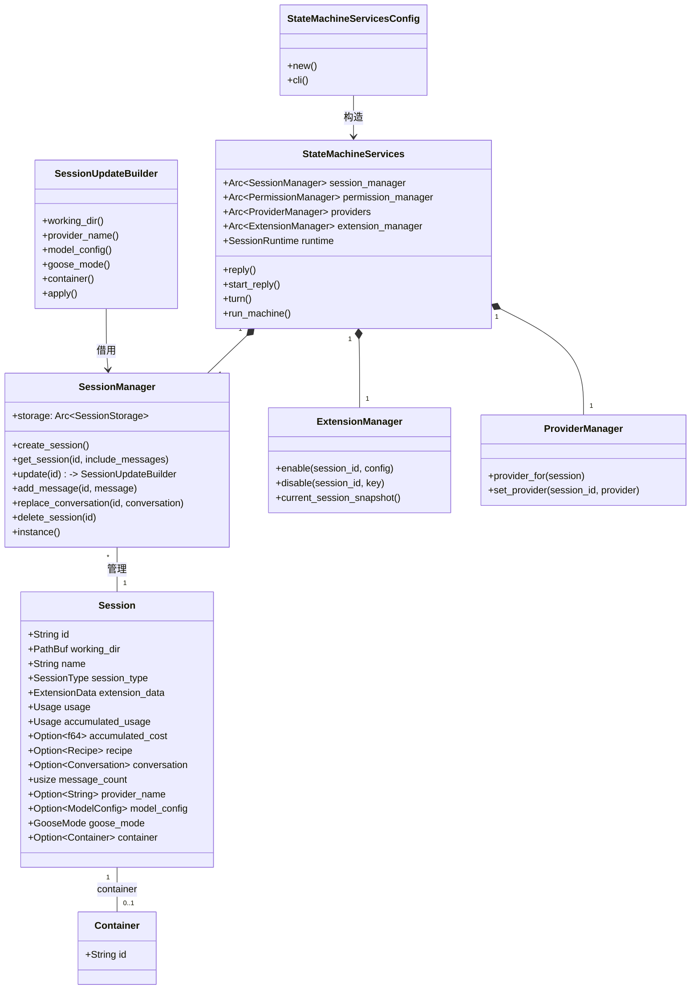

# 04 · 核心模块与类关系

> 层级：L4 源码补齐 · 本文覆盖核心模块的类结构、字段、职责边界与相互关系。核心抽象在 `goose-agent`（GDK 公开），具体实现在 `goose` crate。

## 概览

goose 的运行时由三大类对象组成：

- **Session**：一个持久化的对话单元（含 conversation、provider、model、usage）。
- **StateMachineServices**：运行时中枢，聚合会话、provider、扩展、hooks、runtime 状态；暴露 `reply()`。
- **StateMachine / Operation / Inference**：可复用的泛型 agent 循环骨架（`goose-agent`），goose 用具体 `Session`/`GooseEffect` 实例化。

## Session（会话实体）

`Session`（session_manager.rs · Session+0）是**持久化模型**，字段见上类图。关键点：

- `conversation: Option<Conversation>`：`Conversation(Vec<Message>)`（provider-types/src/conversation.rs · Conversation+0），对话消息序列。`get_session(id, include_messages=true)` 时才填充。
- `usage` / `accumulated_usage`：本轮 / 累计用量；`accumulated_cost` 累计成本。
- `provider_name` / `model_config`：绑定哪个 provider、用什么模型。
- `goose_mode`：Auto / Approve / SmartApprove / Chat（provider-types/src/goose_mode.rs · GooseMode+0）。
- `container: Option<Container>`：该会话的 stdio 扩展运行容器（本地/docker）。
- `recipe` / `user_recipe_values`：recipe 会话绑定。
- `schedule_id`：定时任务触发的会话标识。
- `system_prompt_override` / `system_prompt_extras`：系统提示覆盖。

`Session` 还实现 `From<&Session> for TokenState`（session_manager.rs · Session+37），导出用量给 UI。

## SessionManager（会话存储）

`SessionManager`（session_manager.rs · SessionManager+0）持有 `storage: Arc<SessionStorage>`，是会话持久化的唯一入口：

| 方法 | 行为 | 源码 |
|---|---|---|
| `instance()` | 进程级单例 | +431 |
| `create_session(working_dir, name, type, mode)` | 建新会话 | +462 |
| `create_session_with_id` | 指定 id 建会话 | +474 |
| `get_session(id, include_messages)` | 读会话；`include_messages` 拉 conversation | +487 |
| `update(id)` | 返回 `SessionUpdateBuilder` | +491 |
| `add_message(id, message)` | `BEGIN IMMEDIATE` 事务追加消息 + 更新 updated_at | +510 / storage +2156 |
| `replace_conversation(id, conversation)` | 整段替换对话 | +514 |
| `save_compacted_conversation` | 压缩后覆盖（保留既有 message 元数据） | +518 / storage +2250 |
| `list_sessions` / `list_sessions_by_types` | 列表/按类型 | +528 |
| `delete_session(id)` | 删会话 + messages + usage_ledger | +560 / storage +2529 |

存储层用 **SQLite**（`sqlx`），表 `sessions` / `messages` / `usage_ledger`。`get_session` 的 SQL 见 session_manager.rs · get_session+2。`add_message` 的 INSERT 见 +2177，`BEGIN IMMEDIATE` 事务保证并发安全。

**重要**：`SessionManager` 同时实现 `SessionLoader` 与 `EffectHandler`（state_machine/session.rs · SessionManager+0/+52），是状态机 `run` 的 runtime——状态机的 effects 经它落盘。

## SessionUpdateBuilder（字段更新器）

`SessionUpdateBuilder`（session_manager.rs · SessionUpdateBuilder+0）是**不可变 fluent 更新器**，避免直接改 Session 字段。每个 setter 返回 `Self`，`apply()` 调 `apply_update_inner` → storage。典型字段：`working_dir`、`provider_name`、`model_config`、`goose_mode`、`container`、`schedule_id`、`archived_at`、`system_prompt_*`、`usage`、`accumulated_usage`、`accumulated_cost`。

## StateMachineServices（运行时中枢）

`StateMachineServices`（services.rs · StateMachineServices+0）聚合全部依赖，`reply()` 是唯一对外会话入口。

| 字段 | 类型 | 说明 |
|---|---|---|
| `session_manager` | `Arc<SessionManager>` | 会话存储 |
| `permission_manager` | `Arc<PermissionManager>` | 工具审批 |
| `providers` | `Arc<ProviderManager>` | provider 池 |
| `scheduler` | `Option<Arc<dyn SchedulerTrait>>` | 定时调度（feature scheduler） |
| `goose_platform` | `GoosePlatform` | Cli / Desktop |
| `disable_session_naming` | `bool` | 关会话自动命名 |
| `runtime` | `SessionRuntime` | 会话活跃状态、租约、steer 队列 |
| `extension_manager` | `Arc<ExtensionManager>` | 扩展生命周期 |
| `tool_inspection_manager` | `ToolInspectionManager` | SmartApprove 工具注解 |
| `hook_manager` | `HookManager` | 钩子 |
| `turn_settings` | `Option<TurnSettings>` | 每轮参数覆盖 |

### 构造（`with_config`，services.rs · with_config+0）

- 建 `ExtensionManager`（喂 providers/session_manager/scheduler/client 能力）、`ToolInspectionManager`。
- `runtime.runs.set_services(Arc::downgrade)` 反向绑定。
- 有 scheduler 则 `scheduler.run_jobs_on(&services)`。

### `StateMachineServicesConfig::cli()`（services.rs · cli+0）

进程级单例 `SessionManager::instance()` + `PermissionManager::instance()`，`goose_platform=GooseCli`。其它入口（ACP/Desktop）构造不同 config。

## ExtensionManager（扩展生命周期）

`ExtensionManager`（extension_manager/mod.rs）管理 `ExtensionConfig` 的生命周期，支持四种配置变体（extension.rs · ExtensionConfig+0）：

| 变体 | 说明 |
|---|---|
| `Stdio` | 子进程 MCP server（cmd + args + env） |
| `Builtin` | goose 内置 MCP server（bundled） |
| `Platform` | 运行在 agent 进程内的扩展（直接访问 services） |
| `StreamableHttp` | HTTP-over-UDS/WebSocket MCP server |

关键方法：

- `enable(session_id, config)`（mod.rs · enable+0）：去重（`config.key()`）、复用可重用 slot、`new_slot` 起客户端、`select` 生效。用 `enabling` 锁保证并发 enable 串行。
- `disable(session_id, key)`（mod.rs · disable+0）：从 enabled extensions 移除。
- `current_session_snapshot`：供推理准备拿扩展快照 + 租约。
- 每个客户端实现 `McpClientTrait`（`list_tools` / `call_tool`），平台扩展如 `AppsManagerClient`、`AnalyzeClient`、`SummonClient` 直接实现之。

## Container（运行容器）

`Container`（container.rs · Container+0）极简：只包一个 Docker 容器 id。`new` / `id`。`stdout` 扩展在此容器内运行（`cli.rs` 里 `Container::new(container)` 从 CLI flag 构造）。

## ProviderManager（provider 池）

`ProviderManager`（provider_manager.rs）按 session 绑定 `Arc<dyn Provider>`。`provider_for(&session)` 从 provider_name + model_config 构建；`set_provider` 直接注入。`StateMachineServices::provider()` 依赖它取当前 provider。

## 类关系总结

- `StateMachineServices` **拥有** SessionManager / ExtensionManager / ProviderManager / SessionRuntime。
- `SessionManager` **管理** `Session` 持久化，并作为状态机 runtime（`SessionLoader` + `EffectHandler`）。
- `StateMachine`（goose-agent）**消费** `MachineSession`（`Session` 实现）+ `EffectHandler`（`SessionManager`/`TurnRuntime` 实现）。
- `ExtensionManager` **拥有** 多种 `McpClientTrait` 客户端（stdio/builtin/http/platform）。
- `Container` 是 Session 的一个字段，指示扩展跑在哪个 docker。

## 与 L3 的衔接

`run_machine`（services.rs · run_machine+0）取 `provider` → `create_state_machine` → `run_goose(machine, session_manager, hooks, ...)`，其中 `session_manager` 同时扮演 `SessionLoader`（`machine.run` 里 `runtime.load`）与 `EffectHandler`（effects 落盘）。`turn` 层用 `SessionRuntime` 管理 turn 并发与确认等待。

## 源码索引（绝对行号）

- `crates/goose/src/session/session_manager.rs`：`Session` +0 / `TokenState From` +114 / `SessionUpdateBuilder` +0 / `SessionManager` +0 / `create_session` +0 / `get_session` +0 / `update` +0 / `add_message` +0 / `delete_session` +0 / storage `get_session` +0 / storage `add_message` +0 / storage `save_compacted_conversation` +0
- `crates/goose/src/agents/services.rs`：`StateMachineServicesConfig` +0 / `cli` +0 / `with_config` +0 / `StateMachineServices` +0
- `crates/goose/src/agents/extension_manager/mod.rs`：`enable` +0 / `disable` +0
- `crates/goose/src/agents/extension.rs`：`ExtensionConfig` +0（Stdio/Builtin/Platform/StreamableHttp）
- `crates/goose/src/agents/container.rs`：`Container` +0
- `crates/goose/src/agents/state_machine/session.rs`：`SessionLoader` for SessionManager +0 / `EffectHandler` for SessionManager +0 / `EffectHandler` for TurnRuntime +0
- `crates/goose/src/agents/provider_manager.rs`：provider_for / set_provider
- `crates/goose-agent/src/machine.rs`：`MachineSession` +0 / `SessionLoader` +0 / `EffectHandler` +0 / `StateMachine` +0
- `crates/goose-provider-types/src/conversation.rs`：`Conversation` +0
- `crates/goose-provider-types/src/goose_mode.rs`：`GooseMode` +0