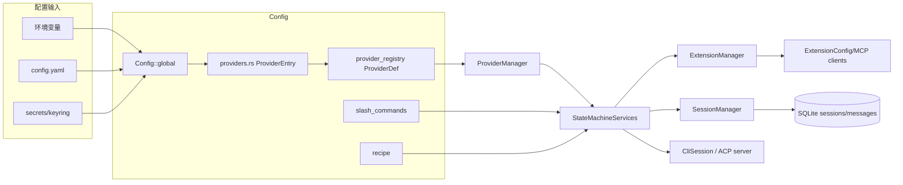

# 06 · 配置与数据流

> 层级：L4 源码补齐 · 本文覆盖配置来源与层级、Provider 目录与注册、recipe 系统、slash commands、扩展加载的数据流。

## 概览

goose 的配置分三类来源，按优先级：

1. **环境变量**（`KEY` 大写）——最高优先；
2. **`config.yaml`**（默认 `~/.config/goose/config.yaml`）——结构配置；
3. **secrets 存储**（keyring / `secrets.yaml`）——敏感值。

Provider 目录（`providers.rs`）+ 注册表（`init.rs`）+ 声明式 provider（`declarative_providers.rs`）决定「哪个 provider 可用、用什么模型」。recipe 系统把复用任务编排成可调度的指令文件。slash commands 把内置命令/recipe/skill 统一成 `/` 命令入口。

## 配置路径（`Paths`，config/paths.rs）

`Paths::get_dir`（paths.rs · get_dir+0）：
- 若 `GOOSE_PATH_ROOT`（绝对路径）设置，则用 `{root}/config`、`{root}/data`、`{root}/state`（`get_dir+1~+9`）；
- 否则按 `choose_app_strategy("Block", "goose")` 走 OS 标准目录（macOS `~/Library/Application Support/Block/goose/`，+22）。

| 方法 | 返回 |
|---|---|
| `config_dir()` | 配置目录 |
| `data_dir()` | 数据目录（会话 DB） |
| `state_dir()` | 状态目录 |
| `plugins_dir()` | `~/.agents/plugins` |
| `agents_dir()` / `agents_home_dir()` | `~/.agents/agents` / `~/.agents` |

## Config 全局实例与读取（config/base.rs）

### `global()`（`global+0`）

```rust
GLOBAL_CONFIG.get_or_init(Config::default)   // 进程级单例，默认路径 ~/.config/goose/config.yaml
```

### `get_param<T>`（`get_param+0`）

```text
key → KEY（大写）→ env::var 命中？→ parse_env_value → serde_json::from_value   [环境变量优先]
否则 → self.load() 读 config.yaml → values.get(key) → serde_yaml::from_value / parse_env_value
```

### `get_secret<T>`（`get_secret+0`）

```text
key → KEY 大写 → env::var 命中？→ parse_env_value   [环境变量优先]
否则 → self.all_secrets()（keyring 或 secrets.yaml）→ values.get(key) → serde_json::from_value
```

`get_secrets`（`get_secrets+0`）：若 primary 在 env，则全部走 env；否则走 secret 存储。

### Provider 相关 accessor（`Config+0`）

- `get_goose_provider`（`get_goose_provider+0`）→ `config::providers::get_active_provider(self)`
- `get_goose_model`（`get_goose_model+0`）→ `get_active_model`
- `set_goose_provider` / `set_goose_model` 写回 active_provider。
- `get_goose_thinking_effort`（`get_goose_thinking_effort+0`）：thinking effort 配置。

## Provider 目录（config/providers.rs）

`ProviderEntry`（providers.rs · ProviderEntry+0）：`enabled` / `model` / `configured`。配置块 `providers:` 结构（`ACTIVE_PROVIDER_KEY = "active_provider"`）：

```yaml
providers:
  active_provider: openai
  providers:
    openai:
      enabled: true
      model: gpt-5
      configured: true
```

`get_active_provider` 优先读结构化 `providers:` 块，回退到旧式扁平键（`GOOSE_PROVIDER` / `GOOSE_MODEL` 等，见 config/base.rs · Config+0 注释）。

## Provider 注册表（providers/init.rs + providers/provider_registry.rs）

`get_from_registry(name)`（init.rs · get_from_registry+0）从注册表读 `ProviderEntry`。注册表把「provider 名称 → ProviderDef 实现」绑定，`ProviderManager::provider_for` 用它构造具体 `Arc<dyn Provider>`。

数据流：

```text
config.get_goose_provider()  →  provider_name
provider_registry 查 provider_name → ProviderDef
ProviderDef::from_env(extensions, tls_config)  →  Arc<dyn Provider>
provider.apply_model_selection(model_config)    →  provider 绑定模型
provider.stream(...)  →  推理
```

声明式 provider（`config/declarative_providers.rs`）：从配置声明的 provider（含 engine、model、base_url）运行时生成 ProviderDef，`get_param`/`get_secret` 读其字段。

## Recipe 系统（recipe/）

Recipe 是 YAML 定义的可复用任务。核心结构（recipe/mod.rs）：
`title` / `description` / `instructions` / `prompt` / `activities`（步骤列表）/ `extensions` / `parameters` / `settings` / `version` / `author`。

### 数据流

| 环节 | 文件 | 行为 |
|---|---|---|
| 解析 | `recipe/mod.rs` | `Recipe::try_from(RecipeDto)`、`load_recipe_from_path` |
| 校验 | `acp/server/recipe/mod.rs · validate_recipe+0` | `validate_recipe` → `to_yaml` → `validate_recipe_template_from_content` |
| 构建 | `build_recipe/build_recipe_from_template` | 模板渲染 + 参数填充 |
| 调度 | `scheduler`（feature） | 定时触发 recipe 会话 |
| 持久化 | `Session.recipe` + `user_recipe_values` | 会话绑定 recipe |
| deeplink | `recipe_deeplink` | `goose://recipe?config=...` 编解码 |

### ACP recipe 方法（server/recipe/mod.rs）

`resolve_recipe_from_meta`（`resolve_recipe_from_meta+0`）：从 `meta.recipeDeeplink` 或 `meta.recipeId` 解析 recipe，`validate_recipe` 校验。还有 `on_encode_recipe` / `on_decode_recipe` / `on_scan_recipe` / `on_list_recipes` / `on_delete_recipe` / `on_schedule_recipe`。

## Slash Commands（slash_commands/）

统一 `/` 命令入口，三个来源合并（`merge_command_sources`，slash_command.rs · merge_command_sources+0）：

| 来源 | 文件 | 命令 |
|---|---|---|
| 内置 | `execute_commands.rs` `COMMANDS`（`COMMANDS+0`） | `/compact` `/clear` `/prompt` `/skills` `/doctor` `/goal` `/exit` 等 |
| Recipe | `recipe_slash_command.rs` `list_commands`（`list_commands+0`） | `config.slash_commands` 里声明的 recipe 映射 |
| Skill | `skill_slash_command.rs` `list_commands`（`list_commands+0`） | `skills::list_installed_skills` 的已装 skill |

`SlashCommandEntry`（types.rs · RetryConfig+0）：`name` / `description` / `source`（Builtin/Recipe/Skill）/ `source_path` / `input_hint`。名称冲突时 recipe 优先于 skill（skill 文档注明）。

状态机里 `SlashCommandOperation` 处理 `/` 命令：命中内置命令走 `execute_commands`，recipe 走 `build_recipe`，skill 走 `SkillOperation`。

## 扩展加载数据流

从 CLI 参数 / 配置 → `ExtensionConfig` → `ExtensionManager::enable`：

```text
CLI extension_opts（-e cmd / --builtin / --with-builtin / streamable-http url）
  → parse_stdio_extension / parse_builtin_extensions / parse_streamable_http_extension（session/mod.rs）
  → Vec<ExtensionConfig>
  → ExtensionManager::enable(session_id, config)  [去重 + 复用 slot + 起客户端]
  → extension.start(config) → Extension（MCP client）
  → current_session_snapshot → 推理时工具/提示注入
```

`Config::global()` 里 `enabled_extensions` 也进 ExtensionManager。`extension_data` 随 Session 持久化。

## 数据流全景



## 关键默认值

| 配置 | 默认 | 位置 |
|---|---|---|
| provider | 无（须 `goose configure`） | builder.rs · resolve_provider_and_model+18 |
| max_sessions | 100 | services.rs · DEFAULT_MAX_SESSIONS+0 |
| thinking effort | config 读 | config/base.rs · get_goose_thinking_effort+0 |
| extension timeout | `DEFAULT_EXTENSION_TIMEOUT` | config |
| max concurrent subagents | 5 | state_machine_builder.rs · build_state_machine+47 |

## 源码索引（绝对行号）

- `crates/goose/src/config/base.rs`：`Config::global` +0 / `get_param` +0 / `get_secret` +0 / `get_secrets` +0 / `get_goose_provider` +0 / `get_goose_model` +0 / `get_goose_thinking_effort` +0 / `parse_env_value`
- `crates/goose/src/config/paths.rs`：`Paths::get_dir` +0 / `config_dir` +0 / `data_dir` +0 / `plugins_dir` +0
- `crates/goose/src/config/providers.rs`：`ProviderEntry` +0 / `ACTIVE_PROVIDER_KEY` +0
- `crates/goose/src/providers/init.rs`：`get_from_registry` +0
- `crates/goose/src/config/declarative_providers.rs`：声明式 provider
- `crates/goose/src/acp/server/recipe/mod.rs`：`resolve_recipe_from_meta` +0 / `validate_recipe` +0
- `crates/goose/src/recipe/mod.rs`：`Recipe` +0 / `builder` +0
- `crates/goose/src/slash_commands/slash_command.rs`：`merge_command_sources` +0 / `list_builtin_commands` +0
- `crates/goose/src/slash_commands/recipe_slash_command.rs`：`list_commands` +0
- `crates/goose/src/slash_commands/skill_slash_command.rs`：`list_commands` +0
- `crates/goose/src/agents/execute_commands.rs`：`COMMANDS` +0 / `list_commands` +0
- `crates/goose/src/agents/extension.rs`：`ExtensionConfig` +0 / `merge_environments` +0
- `crates/goose/src/agents/extension_manager/mod.rs`：`enable` +0 / `start` +0