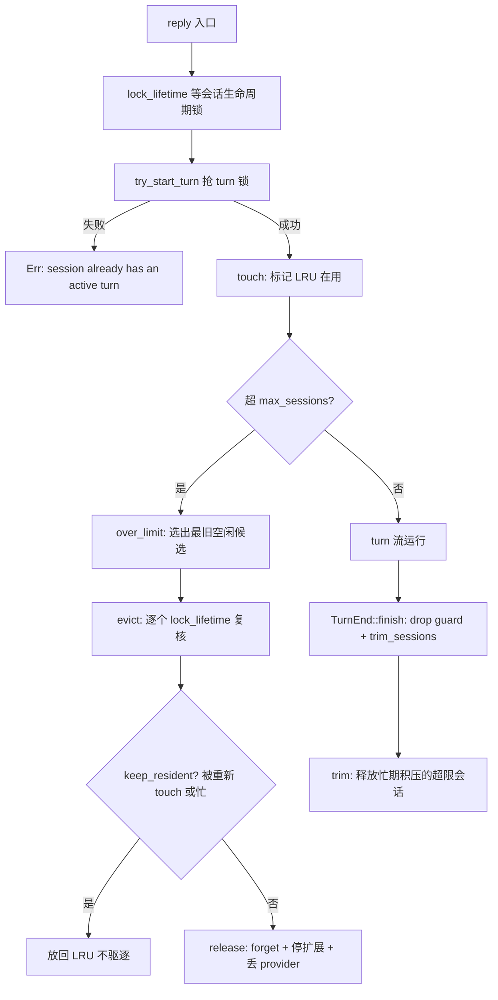

# 07 · 状态机与并发

> 层级：L4 源码补齐 · 本文覆盖 goose 的并发模型：单会话 turn 互斥、多会话驻留与驱逐、取消传播、steer（中途插话）队列、事件泵（Emitter/mpsc）、子代理并发。核心抽象在 `crates/goose-agent/src/machine.rs` 与 `crates/goose/src/agents/session_runtime.rs`。

## 概览

goose 的并发问题只有三类：**同一会话同时只能跑一个 turn**；**进程里同时活着的会话数要受控**；**turn 中途用户可能取消或插话**。对应的四个机制：

| 机制 | 载体 | 解决问题 |
|---|---|---|
| turn 互斥锁 | `SessionToolConfirmationState.turn_lock`（tool_confirmation_coordinator.rs） | 同一会话拒绝第二个并发 turn |
| 驻留 LRU + 驱逐 | `SessionRuntime.resident`（lru::LruCache）+ `over_limit` | 活跃会话数不超 `GOOSE_MAX_ACTIVE_AGENTS`（默认 100） |
| 取消令牌 | `CancellationToken`（tokio-util） | 取消一路传到状态机每步与 provider 流 |
| steer 队列 | `SteerQueue = Arc<Mutex<VecDeque<Message>>>`（ops_steer.rs） | 模型推理间隙拾取用户插话 |

## 生产视角：用户在什么场景下遇到这些机制

### 单会话串行：第二个请求被拒

CLI/ACP 对同一会话发起第二个 prompt 时（前一个 turn 还在跑、连确认都没结束），`try_start_turn` 的 `try_lock_owned` 失败，返回 `anyhow!("session already has an active turn")`（tool_confirmation_coordinator.rs `try_start_turn+40`）。ACP 层另有一层更外圈的 `ActiveRunRegistry`：同一会话同时只允许一个 prompt run 或一个 live 语音交互，互斥错误码在 `StartRunError`（active_run.rs · StartRunError+0）。

### 多会话驱逐：谁先被释放

会话被 touch 后若超过上限，LRU 里最久未用的**空闲**会话被 `evict` 掉：停掉扩展、丢弃 provider、清掉它名下所有运行时状态（services.rs `release+541`：`runtime.forget` + `extension_manager.release` + `providers.release`）。忙会话（有活跃 turn 或有活跃 run）永不驱逐；若全部会话都忙，超限会一直持续到一个 turn 结束（session_runtime.rs `touch+51` 注释明示）。

### 取消：用户看到什么

用户在 turn 中途取消（CLI 退出、ACP `on_cancel`）：turn 不报错，而是「优雅收尾」——已部分推理出的 assistant 消息被落进会话（见 `finalize` 的收尾规则），会话保留可继续。steer 消息若在收尾前已拾取也会被落盘。

### steer：中途插话何时生效

用户在模型推理时发新消息，不会立刻打断，而是排队；在**「模型轮与工具轮之间」**（上一轮是回合结束、或最后 effective role 是 Tool）的下一个 step 被 `SteerOperation` 拾取，作为带 `steer` 标记的用户消息追加进会话并触发 `UserPromptSubmit` hook。拾取时 ACP 侧先向连接方发 `queuedSteer` 通知（client 侧可见「已排队」）。

## 开发视角

### 1. turn 互斥与确认协调（tool_confirmation_coordinator.rs）

`ToolConfirmationCoordinator`（`ToolConfirmationCoordinator+0`）按 session_id 懒创建 `Arc<SessionToolConfirmationState>`（`session+185`）。状态字段（`SessionToolConfirmationState+0~+10`）：

| 字段 | 类型 | 作用 |
|---|---|---|
| `turn_lock` | `Arc<Mutex<()>>`（tokio） | 一个 reply 流独占；`try_lock_owned` 失败即拒绝第二 turn |
| `confirmation_submission_lock` | `StdMutex` | 串行化确认答复提交，防两个并发答案都成功 |
| `confirmations` | `StdMutex<HashMap<String, Option<ConfirmationAnswer>>>` | 当前暂停批次的请求；`None` = 未答 |
| `confirmation_answered` | `Notify` | 唤醒 `wait_for_all_confirmation_answers`；confirmations 仍是唯一事实源 |
| `extension_lease` | `Arc<StdMutex<Option<Arc<ExtensionLease>>>>` | 本轮借用扩展，防 turn 中被全局 disable |

关键行为：

- `try_start_turn`（`try_start_turn+0`）：非阻塞抢锁，失败返回 `Err(anyhow!("session already has an active turn"))`。
- `record_answer`（`record_answer+0`）：已答或请求已不存在时报错，保证一个请求只能答一次；答完 `notify_waiters`。
- `wait_for_all_confirmation_answers`（`wait_for_all_confirmation_answers+0`）：循环等「非空且全部已答」，返回的 bool 表示本批里是否有 `StateMachine(Permission)` 类答案（有才需要再跑一轮机器）；`cancel.cancelled()` 分支返回 `true` 走正常收尾路径。
- 被打断的 turn 保留未答请求到下一轮：`start_new_turn`（`start_new_turn+0`）在**新** turn 开始时才 `clear_confirmations`（测试 `interrupted_turn_keeps_pending_requests_until_the_next_turn` +0 印证）。
- `has_active_turn`（`has_active_turn+0`）用 `turn_lock.try_lock().is_err()` 探测——不持锁也能问「这个会话正忙吗」。
- `ActiveTurnGuard` 的 `Drop`（`ActiveTurnGuard+0`）：释放锁时若确认表为空，顺带清 extension_lease。

### 2. 会话驻留与驱逐（session_runtime.rs + services.rs）



- `SessionRuntime`（`SessionRuntime+0`）字段：`max_sessions`、`resident`（`lru::LruCache`）、`attachments`（连接→会话映射，记录「当前该会话跟谁说话」）、`steer_queues`、`lifetimes`（每会话一把 `Arc<tokio Mutex<()>>`）、`confirmations`、`runs`（`ActiveRunRegistry`）。
- `touch`（`touch+0`）：LRU put 后 `over_limit` 返回驱逐候选，**只选不释放**；释放要 `evict`（services.rs · evict+0）逐个拿生命周期锁再 `keep_resident`（session_runtime.rs · keep_resident+0）复核——候选若刚被 touch 过或刚变忙就留（`demote` 到 LRU 末尾）。
- `forget`（`forget+0`）：清 LRU、附件、steer 队列、coordinator 状态，并 `runs.cancel_agent_run`。
- `is_busy`（`is_busy+0`）：`confirmations.has_active_turn || runs.is_active`。注释点明：live 会话跑起来前没有 turn、prompt 在 turn 开始前先注册 run，所以两路都要看。
- `DEFAULT_MAX_SESSIONS = 100`（services.rs · DEFAULT_MAX_SESSIONS+0），实际值取 `Config::global().get_goose_max_active_agents()`（`new+16`），即配置键 `GOOSE_MAX_ACTIVE_AGENTS`。
- turn 收尾 `TurnEnd`（services.rs · TurnEnd+0）：正常结束时 `finish` 同步 drop guard + `trim_sessions`；流被 drop（客户端断开）时 `Drop` 把 `trim_sessions` 派给 runtime 异步做，避免阻塞。

### 3. 取消传播（CancellationToken 全链）

```text
ACP on_cancel（server.rs · on_cancel+0）
  → ActiveRunRegistry.agent_cancel_token(session_id).cancel()
CLI 侧：reply(cancel_token: Option<CancellationToken>)（services.rs · reply+0）
  → start_reply(cancel) → turn(..., cancel, ...)
  → run_machine(..., cancel) → Emitter::new(tx, cancel.clone())（services.rs · run_machine+54）
  → machine.step: 每步前 cancel.is_cancelled() + tokio::select! 包住 execution（machine.rs · step+0）
  → provider.stream 的流式循环内亦可被 cancel 唤醒 [源码未确认：ops_llm 层逐块 cancel 检查]
```

状态机收尾（machine.rs `finalize+258`）：

1. 未取消直接返回当前 session；
2. 取 `interrupted_step`（被取消时正在执行的 operation 索引）；
3. `interrupted_response`：若会话末尾是中断的 tool 响应，落一条收尾消息；
4. 对每个未被执行到的 operation 调 `finalize_cancellation`，把各自「已产生未落盘」的产物转成 effects 落盘。

各 operation 的 `finalize_cancellation` 产物：

| operation | 文件 | 收尾产物 |
|---|---|---|
| `llm`（InferenceRunner） | inference.rs · finalize_cancellation+0 | `take_output()`：已收 chunk + usage |
| `tools`（ToolOperation） | goose-agent/src/tool.rs · finalize_cancellation+0 | 已产出的 tool 响应消息 |
| `tool_execution` | ops_toolcalling.rs · finalize_cancellation+0 | 批次内已执行的 actions 消息 |
| `steer` | ops_steer.rs · finalize_cancellation+0 | 已拾取未落盘的 steer 消息 |
| `recipe` | ops_recipe.rs · finalize_cancellation+0 | recipe 响应消息 |
| subagent | goose-agent/src/subagent.rs · finalize_cancellation+0 | 已完成的子代理结果消息 + 被取消子代理的取消消息；正在跑的丢弃 |

ACP 取消入口 `on_cancel`（server.rs · on_cancel+0）：按 session 找 run 的 cancel token 直接 `cancel()`；session 不存在时只 warn。

### 4. steer 队列（ops_steer.rs）

- 类型：`SteerQueue = Arc<Mutex<VecDeque<Message>>>`（`SteerQueue+0`）；每会话一份，存在 `SessionRuntime.steer_queues`，`run_machine` 建 machine 时注入（services.rs · run_machine+38）。
- 入队：`StateMachineServices::steer`（services.rs · steer+0）→ `runtime.steer`（session_runtime.rs · steer+0）。ACP 入口 `on_steer_session`（server.rs · on_steer_session+0）：校验 `expected_run_id` 与活跃 run 一致（`require_active_run` +0，防对已结束 turn 插话）→ 生成 `steer_<uuid>` 消息 id → 入队 → 向 client 发 `SessionInfoUpdate` 通知带 `_meta.goose.queuedSteer{messageId, runId}`（`send_queued_steer_update` +0）。
- 拾取条件（`run+60`）：`ends_turn(messages) || last_effective_role == Tool`——即处在「模型轮与工具轮之间」。不满足直接 `not_applicable`。
- 拾取动作：`drain(..)` 全部消息，`with_steer` 标记 → `emit.message` 进流（client 看到 user 消息）→ 每条触发 `UserPromptSubmit` hook → `applied` 落盘。
- 拾取后未落盘前被取消：`finalize_cancellation` 把 `drained` 缓冲转 effects，消息不丢。
- turn 结束后队列残留：下一次 turn 开始时拾取；会话被 `forget` 时 `discard_pending_steers` 清掉（session_runtime.rs · discard_pending_steers+0）。

### 5. 事件泵（Emitter + mpsc）

`run_machine` 建一条 `mpsc::unbounded_channel::<AgentEvent>`（services.rs · run_machine+53），`Emitter`（goose-agent/src/operation.rs · Emitter+0）持发送端与 cancel token：

```rust
pub fn emit(&self, event: AgentEvent) { let _ = self.tx.send(event); }
pub fn message(&self, message: Message) -> Message { ...自补 id...; self.emit(AgentEvent::Message(...)); message }
```

消费端是 `tokio::select!`（services.rs · run_machine+68）：事件先走 `yield` 实时流出，`run`（run_goose future）完成才 break；结束后 `drop(emit)` 再 `while rx.recv()` 排空——注释点名：不 drop 排空永不结束（`run_machine+76`）。`Emitter` 被 operations/inference 全程共享，任何一步产出消息都即时到达 CLI/ACP。

`reply` 出口还有一层 `try_filter_map(user_event)`（services.rs · reply+21，`user_event` +0）：只放行用户可见事件，注释称这是唯一的 live-event 边界。

### 6. 子代理并发（subagent.rs）

`SubagentOperation`（`SubagentOperation+0`）持 `max_concurrency`（默认见 03 篇 `GOOSE_MAX_CONCURRENT_SUBAGENTS = 5`，state_machine_builder.rs · build_state_machine+47）。`run` 里同时跑多个子代理（`SelectAll` 多路事件流）；`pending_subagents`（`pending_subagents+0`）扫描会话找出「请求过但还没结果」的子代理。取消时 `finalize_cancellation`（`finalize_cancellation+0`）只交付已完成的、丢弃在跑的、给被取消的补一条取消消息。父 turn 被 abort 时子代理任务随 future drop 而终止，`SubagentEnding`（subagent_handler.rs · SubagentEnding+0）的 `Drop` 保证子会话照样被 `end_subagent` 释放并发 `SessionEnd` hook。

## 调用关系表

| 调用方与符号 | 关系 | 被调用方与符号 | 触发与输入 | 返回与后续处理 | 错误、状态与副作用 |
|---|---|---|---|---|---|
| `start_reply`+896 | 同步调用 | `SessionRuntime::lock_lifetime` | session_id | `LifetimeGuard` | 阻塞等会话生命周期锁 |
| `start_reply`+898 | 同步调用 | `SessionToolConfirmationState::try_start_turn` | — | `ActiveTurnGuard` | 忙时 `Err(session already has an active turn)` |
| `start_reply`+903 | 同步调用 | `SessionRuntime::touch` | session_id | 驱逐候选 Vec | LRU put |
| `turn`+1054 | 同步调用 | `wait_for_all_confirmation_answers` | cancel | bool（有 SM 答案） | 取消时返回 true 走收尾 |
| `TurnEnd::finish+1377` | 同步调用 | `trim_sessions` | — | — | 释放忙期积压超限会话 |
| `evict+510` | 同步调用 | `keep_resident` | session_id | bool | 忙/被 touch 则放回 LRU |
| `evict+516` | 同步调用 | `release` | session_id | — | `forget` + 停扩展 + 丢 provider |
| `on_cancel`（server.rs）+2329 | 同步调用 | `ActiveRunRegistry::agent_cancel_token` | session_id | `CancellationToken` | `cancel()` 触发全链取消 |
| `step`（machine.rs）+165 | 动态调用 | `tokio::select!` 包 `execution` / `cancel` | — | `OperationResult` / 取消 | 记录 `interrupted_step` |
| `finalize`+267 | 同步调用 | `finalize_step_cancellation` | 每个 step | `Session` | 收尾产物落盘 |
| `on_steer_session`（server.rs）+2293 | 同步调用 | `require_active_run` | session_id, expected_run_id | run_id | run 不匹配则 `invalid_params` |
| `on_steer_session`+2305 | 同步调用 | `StateMachineServices::steer` | session_id, message | — | 入队 + `queuedSteer` 通知 |
| `SteerOperation::run`+73 | 同步调用 | `queue.lock().drain(..)` | — | Vec<Message> | 非 between-turns 时不拾取 |

## 关键常量与配置

| 常量/配置 | 值 | 位置 |
|---|---|---|
| `DEFAULT_MAX_SESSIONS` | 100 | services.rs · DEFAULT_MAX_SESSIONS+0 |
| `GOOSE_MAX_ACTIVE_AGENTS` | 配置键，覆盖默认 100 | services.rs · new+16（`get_goose_max_active_agents`） |
| turn 互斥锁 | 每会话一把 tokio `Mutex` | tool_confirmation_coordinator.rs · SessionToolConfirmationState+2 |
| `SteerQueue` | `Arc<Mutex<VecDeque<Message>>>` | ops_steer.rs · SteerQueue+0 |
| `GOOSE_MAX_CONCURRENT_SUBAGENTS` | 5（默认） | state_machine_builder.rs · build_state_machine+47（见 03 篇） |

## 验证记录

- turn 互斥语义由 `crates/goose/src/agents/tool_confirmation_coordinator.rs` 内测试印证：`rejects_a_second_active_turn_and_releases_on_drop`（`rejects_a_second_active_turn_and_releases_on_drop+0`）、`waits_for_every_confirmation_in_the_batch`（`waits_for_every_confirmation_in_the_batch+0`）、`interrupted_turn_keeps_pending_requests_until_the_next_turn`（`interrupted_turn_keeps_pending_requests_until_the_next_turn+0`）、`first_answer_is_immutable`（`first_answer_is_immutable+0`）。
- 驱逐选 LRU 空闲会话：`crates/goose/src/agents/services.rs` 测试 `eviction_releases_the_least_recently_used_idle_session`（`eviction_releases_the_least_recently_used_idle_session+0`）。
- 跨连接 steer 找到同一 run：`crates/goose/src/acp/server_factory.rs` 测试 `a_steer_on_another_connection_finds_the_run`（`a_steer_on_another_connection_finds_the_run+0`）。
- 取消收尾：`crates/goose-agent/tests/cancellation.rs`（存在，未逐行读，行为以 machine.rs `finalize` 为准）。
- 未实测：运行期 LRU 驱逐与取消时序未做生产实测 `[待运行验证]`。

## 与相邻篇的衔接

- 03 篇（主链路拆解）：本文的 `turn`/`run_machine` 骨架在 03 有逐步代码，本文只补并发原语。
- 05 篇（API 与接口设计）：ACP 侧 `session/request` 与 `session/cancel` 契约见 05，本文讲其背后的 run/turn 双层互斥。

## 源码索引（绝对行号）

- `crates/goose/src/agents/tool_confirmation_coordinator.rs`：`SessionToolConfirmationState` +0 / `try_start_turn` +0 / `register_request` +0 / `record_answer` +0 / `wait_for_all_confirmation_answers` +0 / `start_new_turn` +0 / `ActiveTurnGuard` +0 / `Drop for ActiveTurnGuard` +166 / `ToolConfirmationCoordinator` +0 / `session` +0 / `has_active_turn` +0 / `release` +0
- `crates/goose/src/agents/session_runtime.rs`：`SessionRuntime` +0 / `new` +0 / `touch` +0 / `trim` +0 / `lock_lifetime` +0 / `steer_queue` +0 / `steer` +0 / `discard_pending_steers` +0 / `keep_resident` +0 / `is_busy` +0 / `forget` +0 / `LifetimeGuard` +0
- `crates/goose/src/agents/services.rs`：`DEFAULT_MAX_SESSIONS` +0 / `max_sessions` 配置 `new+16` / `trim_sessions` +0 / `evict` +0 / `release_session` +0 / `release_session_if_closed` +0 / `release` +0 / `steer` +0 / `TurnEnd` +0 / `finish` +0 / `start_reply` turn_guard 段 `start_reply+57~+68`
- `crates/goose/src/agents/active_run.rs`：`StartRunError` +0 / `ActiveRunRegistry` +0 / `start_prompt_run` +0 / `start_live_delegation` +0 / `agent_run_id` +0 / `agent_cancel_token` +0 / `cancel_agent_run` +0 / `start_live` +0 / `finish_live` +0 / `is_active` +0
- `crates/goose/src/agents/state_machine/ops_steer.rs`：`SteerQueue` +0 / `SteerOperation` +0 / `take_drained` +0 / `finalize_cancellation` +0 / `run` +0
- `crates/goose/src/acp/server.rs`：`require_active_run` +0 / `send_queued_steer_update` +0 / `on_steer_session` +0 / `on_cancel` +0
- `crates/goose-agent/src/machine.rs`：`step` +0（cancel select）/ `run` +0 / `finalize` +0 / `finalize_step_cancellation` +0 / `save` +0
- `crates/goose-agent/src/operation.rs`：`Emitter` +0 / `emit` +0 / `message` +0 / `cancelled` +0
- `crates/goose-agent/src/subagent.rs`：`SubagentOperation` +0 / `pending_subagents` +0 / `finalize_cancellation` +0
- `crates/goose/src/agents/subagent_handler.rs`：`SubagentEnding` +0 / `Drop` +0 / `end_subagent` +0
