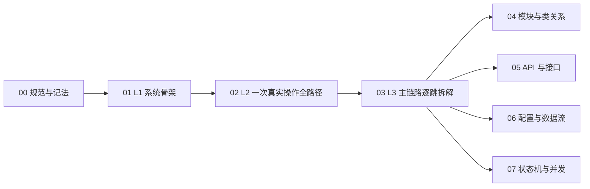

# goose 源码阅读文档库

> 代码基准：`main@71dd9a9aa`（当前 HEAD，工作区仅 docs/、.codegraph/ 未跟踪）；核实日期：2026-11-18。
> 刷新验证：0 提交漂移，15/15 crate 覆盖，无新增能力缺口。记法已升级为「符号+偏移」（`file.rs · Symbol+N`），161 处正文/索引引用 + 55 处裸续引用反向逐条回核通过。
> goose 是 Rust 实现的 AI Agent 框架（CLI + Electron 桌面 + ACP server）。本文档库按四层递进：先骨架、再走一遍真实例子、再逐跳拆主链路、最后按主题补齐开发细节。规范与记法见 00。

## 学习路径



## 目录

| 篇 | 层级 | 一句话定位 | 状态 |
|---|---|---|---|
| [00 规范与定位约定](00-docs-style-guide.md) | meta | 事实红线、符号+偏移锚点记法、成稿规范 | 已完成 |
| [01 简单框架：系统骨架](01-简单框架-系统骨架.md) | L1 | 系统由什么组成、请求怎么走；不展开实现细节 | 已完成 |
| [02 简单例子：全路径走读](02-简单例子-全路径走读.md) | L2 | 沿一条最小成功路径从 CLI 入口追到 agent 回复 | 已完成 |
| [03 详细逐步说明：主链路拆解](03-详细逐步说明-主链路拆解.md) | L3 | `reply → turn → run_machine → step → infer → apply` 逐跳代码级拆解 + 时序图 | 已完成 |
| [04 核心模块与类关系](04-核心模块与类关系.md) | L4 | Session/SessionManager/StateMachineServices/ExtensionManager/ProviderManager 的结构与所有权 | 已完成 |
| [05 API 与接口设计](05-API与接口设计.md) | L4 | ACP（server + client provider）、`Provider` trait、`ProviderDef`、`ExtensionConfig` 契约 | 已完成 |
| [06 配置与数据流](06-配置与数据流.md) | L4 | 配置来源与优先级、Provider 注册、recipe、slash commands、扩展加载数据流 | 已完成 |
| [07 状态机与并发](07-状态机与并发.md) | L4 | turn 互斥、会话驻留/驱逐、取消传播、steer 队列、Emitter 事件泵、子代理并发 | 已完成 |

## 主链路速览

```text
CLI/ACP prompt
  → StateMachineServices::reply（services.rs，会话入口，唯一 live-event 边界）
  → start_reply：抢 turn 锁（一会话一 turn）→ 用户消息落盘
  → turn：循环跑状态机，遇工具确认暂停等答复
  → run_machine：取 provider/model → create_state_machine → run_goose（mpsc 事件泵）
  → StateMachine::run：loop { step → apply }，直到 Yielded/Cancelled
  → step：operations 顺序短路命中即停；全不适用才走 InferenceRunner
  → infer：请求准备（system prompt/tools）→ provider 流式推理 → 消息/usage effects
  → apply_effects：SessionManager 落盘（AppendMessage/Compact/Usage…）
  → AgentEvent 实时流回 CLI/ACP
```

并发四原语速记：**turn 锁**（一会话一 turn，`try_start_turn`）、**LRU 驻留**（`GOOSE_MAX_ACTIVE_AGENTS`，默认 100，忙会话不驱逐）、**cancel 令牌**（全链 select + `finalize_cancellation` 收尾落盘）、**steer 队列**（模型轮间隙拾取，`steer_<uuid>` 消息）。
